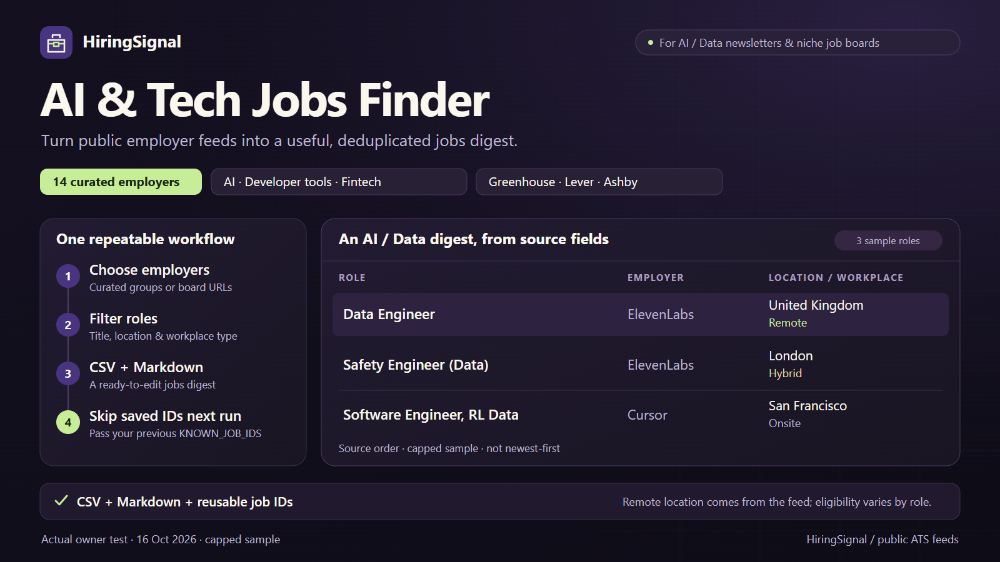

# HiringSignal: AI & Data Jobs Finder


[Run on Apify Store](https://apify.com/reliable_quatrain/greenhouse-lever-ashby-jobs-hiring-signal) · [First run](docs/FIRST_RUN.md) · [Hướng dẫn tiếng Việt](docs/FIRST_RUN_VI.md)



Build a jobs shortlist for an AI/Data newsletter or niche job board without first
finding every employer's ATS address. Select a curated company group and role
preset, then export matching public Greenhouse, Lever and Ashby postings as CSV,
JSON, RSS 2.0, JSON Feed 1.1 and a reviewable Markdown newsletter draft.

```json
{
  "companyGroup": "ai",
  "rolePreset": "data-ai",
  "maxJobs": 6,
  "maxJobsPerBoard": 2
}
```

The curated watchlist is a bounded starting point, not a search of all employers
or every job on the internet. Results follow selected board/provider order, not
a newest-first ranking. Use `boards` to add your own supported employer feeds;
explicit boards run first and the chosen group is added without duplicates.

## Run locally

```powershell
python -m venv .venv
.\.venv\Scripts\python.exe -m pip install -e ".[actor]"
.\.venv\Scripts\python.exe -m hiringsignal catalog
.\.venv\Scripts\python.exe -m hiringsignal run --input examples/ai-data-newsletter.json --output output
```

`catalog` prints the curated employers, board keys and exact role-preset title
terms; [catalog notes](docs/CATALOG.md) explain its scope. Local output includes `results.json`, spreadsheet-safe `results.csv`,
`newsletter.md`, `summary.json`, `diagnostics.json` and `known_job_ids.json`.
The newsletter contains only saved rows and should be reviewed before publishing.
`jobs.rss` and `jobs.feed.json` contain the same saved jobs for feed readers and
job-board integrations. Each file is a static export of one run. Source dates
remain source dates; missing publication dates are omitted rather than replaced
with the run time. See the [feed integration guide](docs/FEED_INTEGRATION.md)
or [huong dan tieng Viet](docs/FEED_INTEGRATION_VI.md).

For a later run, load the previous saved-job keys:

```powershell
.\.venv\Scripts\python.exe -m hiringsignal run --input examples/ai-data-newsletter.json --previous-ids output/known_job_ids.json --output output-next
```

The CLI merges these keys with any input `knownJobIds`, subject to the same
10,000-key input bound. It skips known keys before saving or billing. Cloud runs
require copying the `KNOWN_JOB_IDS` array into the next input; a schedule alone
does not transfer state. See the [first-run guide](docs/FIRST_RUN.md).

## Know what you are getting

- `companyGroup`: `none`, `ai`, `developer-tools`, `fintech` or `all`.
- `rolePreset`: `all`, `data-ai`, `engineering`, `product-design` or `sales-marketing`.
- Optional title, location, explicit remote and publication-date filters combine
  with the preset. Source dates and remote eligibility have limits; see the
  [Store product guide](.actor/README.md).
- `employmentTypes` optionally selects explicit source employment labels mapped
  to full-time, part-time, contract, temporary, internship, freelance,
  apprenticeship or unknown. Missing/ambiguous labels are never guessed from
  titles or descriptions. Filtering happens before saving and billing.
- An unseen saved key is not proof of a newly published job. Missing records
  never become closure or hiring-growth claims.
- Board caps make small runs deliberately partial. Inspect `DIAGNOSTICS` before
  using job counts for research or comparing employers.
- If every attempted source fails, the run fails with diagnostics and no saved-job
  events. A successful empty feed or zero filter matches remains a valid result.

The configured Apify Actor fee is **$0.0015 per saved matching job ($1.50 per
1,000)**. Six saved jobs correspond to $0.009 in Actor events; the Store Pricing
tab and displayed platform charges control the actual cost. Local runs do not
charge Apify events. Free/owner trials are not evidence of customer revenue.

[Vietnamese workflow cookbook](docs/WORKFLOW_COOKBOOK_VI.md) ·
[Development and deployment](docs/README.md) ·
[Launch verification](docs/LAUNCH_STATUS.md) ·
[Launch post drafts](docs/LAUNCH_POSTS.md) ·
[Kế hoạch tìm người dùng](docs/ACQUISITION_PLAN_VI.md)

The source is MIT licensed. Employer job content remains subject to its owners'
terms and applicable use requirements. Employer names are watchlist labels, not
customers, partnerships or endorsements.
